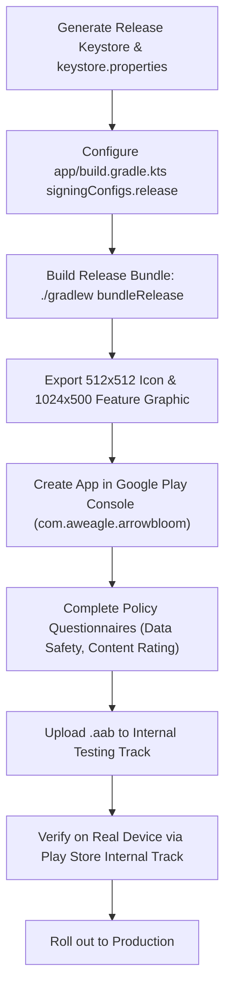

# Arrow Bloom — Google Play Store Launch Readiness Checklist

**Status**: NOT READY (Phase: Gameplay Complete $\to$ Store Release Preparation)  
**Package**: `com.aweagle.arrowbloom`  
**Target Tracks**: Internal Testing $\to$ Closed Testing $\to$ Production  
**Last Updated**: 19 Oct 2026

---

## 1. Summary Assessment
- **Gameplay & Mechanics**: **READY (100%)** — Core puzzle engine, DAG generator, Compose Canvas renderer, animations, HUD, combos, undo, hints, victory dialog, level progression, and local persistence are verified on real emulator.
- **Store & Release Pipeline**: **NOT READY (Blocked on 4 Items)** — Requires release keystore, `.aab` signing, store visual assets, Play Console listing creation, and haptics/audio/monetization polish.

---

## 2. Mandatory Technical Requirements (Google Play Policy)

| Item | Requirement | Current State | Action Needed |
| :--- | :--- | :--- | :--- |
| **Artifact Format** | Android App Bundle (`.aab`) | Only debug `.apk` built | Run `./gradlew bundleRelease` |
| **Release Signing** | RSA 2048+ or EC Key with v2/v3 signature | Unsigned / Debug keystore only | Generate `arrowbloom-release.jks`, configure `keystore.properties` |
| **Minification / ProGuard** | R8 code & resource shrinking enabled | Configured in `app/build.gradle.kts` | Verify release build outputs clean binary (~7–9 MB) |
| **Target SDK** | Android 15 (API 35) | `targetSdk = 35` | Compliant with Google Play 2025/2026 requirements |
| **Privacy Policy** | Active HTTP 200 URL declaring data handling | Existing policy at `https://ajay-waghmare.github.io/app-policy/privacy-policy.html` | Reuse verified AW EagleCraft privacy policy |

---

## 3. Mandatory Google Play Console Listing Assets

| Asset | Specifications | Status |
| :--- | :--- | :--- |
| **High-Res App Icon** | $512 \times 512$ PNG, 32-bit color, max 1 MB | Pending export from vector drawable |
| **Feature Graphic** | $1024 \times 500$ PNG or JPEG, max 15 MB | Pending creation |
| **Phone Screenshots** | At least 4 screenshots, 16:9 or 9:16 aspect ratio (min 1080px) | **Captured** (4 real 1080x2400 Pixel 8 gameplay screenshots ready) |
| **App Title** | Arrow Bloom (max 30 chars) | Ready |
| **Short Description** | Clean, addictive arrow escape logic puzzle (max 80 chars) | Ready |
| **Full Description** | Formatted store listing highlighting offline play, relaxing neon visuals, infinite levels | Ready |

---

## 4. In-App Polish & Monetization Checklist (Pre-Launch)

- [ ] **Haptic Feedback**:
  - Soft vibration click on successful arrow tap.
  - Double warning buzz on blocked collision shake.
- [ ] **Audio**:
  - Subtle aerodynamic whoosh on arrow launch.
  - Luminous chime on level completion.
  - Mute audio toggle in settings/header.
- [ ] **AdMob Integration**:
  - Banner ad on non-gameplay screens or bottom footer safe zone.
  - Rewarded ad: "Watch an ad to get +3 hints".
  - Reuse Block Bloom AdMob app ID or set up dedicated Arrow Bloom ad unit IDs.

---

## 5. Deployment Step Sequence

